# Finding joy in learning, one byte at a time.

Hi! I'm **Christine Joy Balansay (Joy)** — a data engineer with a background in Financial Management and risk operations, an FTW Data Engineering Batch 12 graduate, and a Databricks Certified Data Engineer Associate.

I enjoy turning messy data into information people can trust. Here, I share the projects I build, the lessons I learn, and the small wins along the way.

## Links

**Build & explore**

- [Project journal](https://github.com/JoyInBytes/ftw-de-journal) — what I built, what I learned, and what comes next.
- [Chinook Sales Data Warehouse](https://github.com/ItsYangCoder/d3-chinook-dimensional-model) — a team project using Databricks SQL, dimensional modeling, and Tableau.
- [Pac-Joy](https://pac-joy-data-maze.ceejaybalansay23.chatgpt.site) — a playful way to explore data pipelines and SQL.

**Learn & share**

- [Learning notes](https://github.com/JoyInBytes/learning-notes) — beginner-friendly notes on Git, GitHub, and data engineering.
- [Daily learning logs](https://github.com/JoyInBytes/ftw-de-journal/tree/main/daily-logs) — small steps, questions, and discoveries.
- [Lakehouse Ready](https://lakehouse-ready.ceejaybalansay23.chatgpt.site) — Databricks certification practice and study resources.

**Elsewhere**

- [LinkedIn](https://www.linkedin.com/in/christine-joy-balansay-cfmp-b132b5277/) — my learning journey, projects, and career updates.

Right now, I'm focused on reliable pipelines, data quality, dimensional modeling, and documentation that makes the next person's work easier.

## Stack

- **Languages:** SQL, Python
- **Data engineering:** Databricks, Apache Spark, Delta Lake, ETL/ELT, Lakeflow Jobs
- **Modeling & quality:** Medallion architecture, star schemas, Great Expectations, reconciliation
- **Analytics:** Tableau
- **Tooling:** Git, GitHub, GitHub Actions, CI/CD

## Beyond the code

- 🎓 Financial Management graduate, cum laude — bringing a business and risk perspective to data.
- 🌱 It took three attempts to get into FTW. I kept trying, graduated, and earned my Databricks certification.
- ✍️ I like documenting the journey, including the parts I'm still figuring out.
- 🏃‍♀️ I enjoy a morning run and the small progress that comes with showing up.
- 🤝 Faith, family, and serving my community keep me grounded.

## Contribution activity

<picture>
  <source media="(prefers-color-scheme: dark)" srcset="https://raw.githubusercontent.com/JoyInBytes/JoyInBytes/output/pacman-contribution-graph-dark.svg" />
  <source media="(prefers-color-scheme: light)" srcset="https://raw.githubusercontent.com/JoyInBytes/JoyInBytes/output/pacman-contribution-graph.svg" />
  
</picture>

Learning and building, one contribution at a time.

---

*Fueled by lifelong learning, grounded in purpose — one pipeline at a time.*
